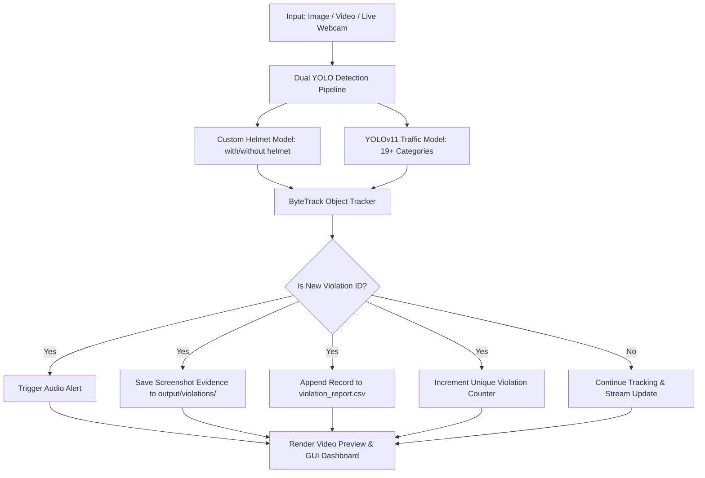

# 🚦 AI Traffic Safety & Helmet Violation Monitoring System

[](https://www.python.org/)
[](https://docs.ultralytics.com/)
[](https://opencv.org/)
[](https://github.com/ifzhang/ByteTrack)
[](LICENSE)

An intelligent, real-time computer vision system that monitors traffic safety and enforces helmet compliance for motorcyclists. Combining a custom-trained **YOLO helmet detector** with a **YOLOv11 multi-class traffic detector**, the system detects 21+ object categories, tracks vehicles and riders across frames with **ByteTrack**, eliminates duplicate violation counts, triggers instant sound alerts, and logs timestamped photographic evidence into automated CSV reports.

---

## 🌟 Key Features

- 🏍️ **Dual-Model Computer Vision Engine**:
  - **Custom Helmet Detector**: Specialized YOLO model identifying `with helmet` and `without helmet` riders.
  - **COCO Traffic Detector**: Pre-trained YOLOv11s model detecting 19+ urban traffic categories (cars, motorcycles, bicycles, buses, trucks, pedestrians, traffic lights, stop signs, etc.).
- 🎯 **ByteTrack Multi-Object Tracking**:
  - Assigns unique tracking IDs across video frames and live webcam streams.
  - **Duplicate Count Elimination**: Violators are counted strictly **once per unique tracking ID**, preventing frame-by-frame duplicate inflation.
- 🔊 **Automated Alert System**:
  - Triggers audible sound alerts immediately upon detecting a new violator.
  - Compatible with `pygame` (`alert.wav`) and fallback system beeps on Windows.
- 📸 **Photographic Evidence Logging**:
  - Automatically captures and saves cropped high-resolution evidence screenshots for every new violation.
  - Generates structured CSV incident reports (`violation_id`, `time`, `source`, `track_id`, `class_name`, `confidence`, `image_path`).
- 💻 **Modern Interactive GUI Dashboard**:
  - Sleek dark-mode Tkinter GUI with custom rounded cards and live metric displays.
  - Video player, webcam live stream, single-image analysis, real-time FPS counter, and quick CSV log inspection.
- ⚡ **Full Pipeline Flexibility**:
  - Supports single image analysis, local/CCTV video files, and live RTSP/webcam feeds.

---

## 📊 System Architecture



---

## 🔍 Supported Classes (21+ Categories)

The system actively detects and classifies 21 distinct urban traffic and helmet classes:

| Category Type | Classes |
| --- | --- |
| **Helmet Compliance** | `with helmet` (Safe), `without helmet` (Violation) |
| **Vehicles** | `motorcycle`, `bicycle`, `car`, `bus`, `truck` |
| **Pedestrians & Personal** | `person`, `backpack`, `handbag`, `umbrella`, `cell phone` |
| **Traffic Infrastructure** | `traffic light`, `stop sign`, `fire hydrant`, `parking meter` |
| **Animals & Street Misc** | `dog`, `cat`, `bench`, `chair`, `skateboard` |

---

## 📁 Repository Structure

```text
├── Traffic-System-Safety-Monitor-main/  # Core monitoring system
│   ├── best.pt                          # Custom trained helmet YOLO weights (~22MB)
│   ├── yolo11s.pt                       # Multi-class traffic YOLOv11s weights (~19MB)
│   ├── traffic_safety_system.py         # Main engine (ByteTrack, detection, logging)
│   ├── gui.py                           # Modern Tkinter dashboard UI
│   ├── detect_video.py                  # Video processor CLI
│   ├── detect_single_image.py           # Image processor CLI
│   ├── detect_webcam.py                 # Live webcam CLI
│   ├── evaluate_metrics.py              # Model validation & metrics script
│   ├── train_yolo11s.py                 # YOLOv11 training pipeline
│   ├── bike_1.mp4                       # Sample demo traffic video 1
│   ├── bike_2.mp4                       # Sample demo traffic video 2
│   ├── pic_test.jpg                     # Sample demo test image
│   ├── sample_data/                     # Curated sample images & labels for quick testing
│   │   ├── images/                      # Sample test images (helmet & no-helmet)
│   │   ├── labels/                      # Corresponding YOLO format labels
│   │   └── data_sample.yaml             # Sample dataset configuration
│   ├── Model/                           # Alternate & lightweight models (yolo11n, yolov8s)
│   └── run_gui.bat                      # Quick GUI launcher script
├── detect_single_image.py               # Root quick-launcher for images
├── detect_video.py                      # Root quick-launcher for videos
├── detect_webcam.py                     # Root quick-launcher for webcam
├── gui.py                               # Root quick-launcher for GUI
├── run_gui.bat                          # One-click Windows desktop launcher
├── requirements.txt                     # Python dependencies
└── README.md                            # Complete documentation
```

---

## 📦 Dataset Information

Due to GitHub repository size recommendations, the complete raw training dataset (over 8,000 high-resolution images, ~1 GB) is hosted externally.

- **Full Dataset Source**: [Roboflow Universe - Helmet Detection FK6IS](https://universe.roboflow.com/onlytusik/helmet-detection-fk6is/dataset/1)
- **Included Samples**: A curated set of test images and annotations is included out-of-the-box in `Traffic-System-Safety-Monitor-main/sample_data/` so you can test immediately without downloading the full dataset.
- **Demo Videos**: Pre-packaged with `bike_1.mp4` and `bike_2.mp4` for instant testing of video tracking and violation counting.

---

## 🚀 Getting Started

### 1. Prerequisites

Ensure you have Python 3.8+ installed:

```bash
python --version
```

### 2. Clone Repository

```bash
git clone https://github.com/bzwaqar/AI-Traffic-Safety-Helmet-Violation-Monitoring-System-.git
cd AI-Traffic-Safety-Helmet-Violation-Monitoring-System-
```

### 3. Install Dependencies

```bash
pip install -r requirements.txt
```

---

## 🖥️ Usage Guide

### Launching the Interactive GUI

Simply double-click `run_gui.bat` or run:

```bash
python gui.py
```

### Command Line Interface (CLI)

#### 1. Video Processing with Tracking & Duplicate Elimination
```bash
python detect_video.py Traffic-System-Safety-Monitor-main/bike_1.mp4 --confidence 0.5
```
*To preview the video in real-time while processing, add `--preview`.*

#### 2. Single Image Detection
```bash
python detect_single_image.py Traffic-System-Safety-Monitor-main/pic_test.jpg --confidence 0.5
```

#### 3. Real-Time Webcam Stream
```bash
python detect_webcam.py --camera 0 --confidence 0.5
```

#### 4. Model Evaluation & Benchmark Metrics
```bash
cd Traffic-System-Safety-Monitor-main
python evaluate_metrics.py --data sample_data/data_sample.yaml --split test
```

---

## 📈 Model Performance & Results

The system evaluates tracking precision, recall, and detection metrics:

| Metric | Target / Observed |
| --- | --- |
| **Precision** | > 85% |
| **Recall** | > 82% |
| **mAP@50** | > 88% |
| **Average Processing Speed** | 30–45 FPS (GPU) / 15–25 FPS (CPU) |
| **Duplicate Count Reduction** | 100% per unique track ID |

---

## 📄 Output Artifacts

All run outputs are automatically saved in the `output/` directory:
- **`output/violations/`**: Timestamped screenshot evidence of violators.
- **`output/violation_report.csv`**: Full incident report log with track IDs and confidence scores.
- **`output/video_results/`**: Rendered tracking videos showing bounding boxes, track IDs, and metrics.

---

## 🤝 Contributing

Contributions, issues, and feature requests are welcome! Feel free to check the [issues page](https://github.com/bzwaqar/AI-Traffic-Safety-Helmet-Violation-Monitoring-System-/issues).

## 📝 License

Distributed under the MIT License. See `LICENSE` for more information.
